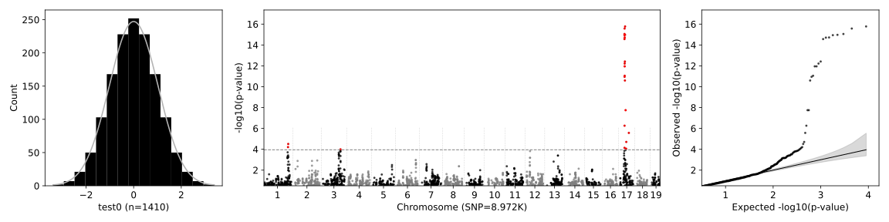
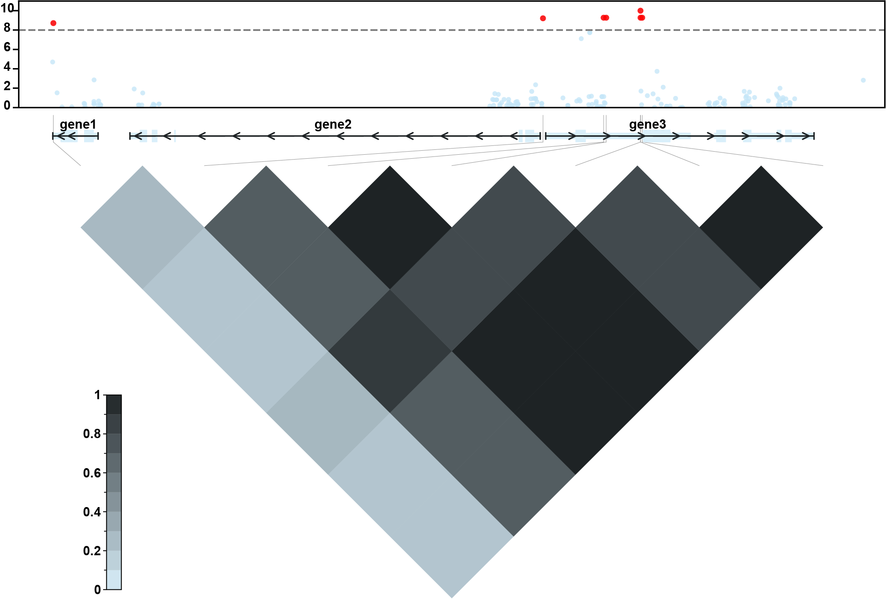
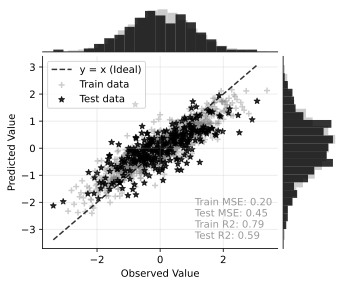

# JanusX

[CLI Guide](./doc/JanusXcli.md) | [Core API Guide](./doc/JanusXcore.md) | [v2.0.1 Release](./doc/release/v2.0.1.md)

[](https://github.com/FJingxian/JanusX/releases/latest)  

## Overview

JanusX (Joint Association and Novel Utility for Selection) is a GWAS and genomic selection toolkit that combines:

- Rust-accelerated kernels (PyO3 extension)
- Python analysis modules
- A Rust launcher (`jx`) for runtime/toolchain management and pipeline orchestration

```text
       _                      __   __
      | |                     \ \ / /
      | | __ _ _ __  _   _ ___ \ V /
  _   | |/ _` | '_ \| | | / __| > <
 | |__| | (_| | | | | |_| \__ \/ . \
  \____/ \__,_|_| |_|\__,_|___/_/ \_\ Tools for GWAS and GS
  ---------------------------------------------------------
```

**Main capabilities**:

- Genome-Wide Association Study (GWAS): `lm`, `lmm`, `lmm2`, `fvlmm`, SparseLMM (`splmm` / `splmm-exact`), `farmcpu`, and cis/trans pair scans (`ct`)
- Genomic Selection (GS): `BLUP`, `BayesA/B/C/R`, PLS/KRR, and ML models (`RF/ET/GBDT/XGB/SVM/ENET`)
- Streaming genotype IO for VCF/HMP/PLINK BED and PLINK 2 PGEN
- Post-analysis workflows: `postgwas`, `postgs`
- Population analysis: `adamixture`, `fst`, and `xpclr`
- Utility workflows: `grm`, `pca`, `gformat`, and `gmerge`

---

## Installation

### Quick installation: Python with uv (recommend)

* Linux | MacOS
```Bash
curl -fsSL https://raw.githubusercontent.com/FJingxian/JanusX/main/scripts/install.sh | sh
```

* Windows
```PowerShell
powershell -ExecutionPolicy ByPass -c "irm https://raw.githubusercontent.com/FJingxian/JanusX/main/scripts/install.ps1 | iex"
```

### Option A: Python package install

```Bash
pip install janusx==2.0.1
```

### Option B: Conda / Bioconda

```Bash
conda create -n janusx \
  --channel conda-forge \
  --channel bioconda \
  janusx
```

### Build wheels with GitHub Actions

Repository collaborators with write access can open
[Build Wheels](https://github.com/FJingxian/JanusX/actions/workflows/build-wheel.yml),
choose **Run workflow**, and select the source, platform, and whether to include the source
distribution. Download `wheels-all` and, when selected, `sdist` from that workflow run. GitHub
Actions artifacts require a GitHub login.

Users without write access to this repository should fork the repository, enable Actions in their
fork if GitHub asks, and run **Build Wheels** there. Build outputs are uploaded as Actions artifacts
in that user's fork; the workflow does not create GitHub Releases.

---

## Quick start

### 1) GWAS

```Bash
# Estimate variance for every SNP.
jx gwas -vcf example/mouse_hs1940.vcf.gz -p example/mouse_hs1940.pheno -lmm -o test/
# Exact LMM with Wald and likelihood-ratio results.
jx gwas -vcf example/mouse_hs1940.vcf.gz -p example/mouse_hs1940.pheno -lmm2 -o test/
# Estimate variance once in NULL model, similar with EMMAX. (fast, recommend)
jx gwas -vcf example/mouse_hs1940.vcf.gz -p example/mouse_hs1940.pheno -fvlmm -o test/
# SparseLMM with sparse REML null and approximate GRAMMAR-gamma scan.
jx gwas -vcf example/mouse_hs1940.vcf.gz -p example/mouse_hs1940.pheno -splmm -o test/
# SparseLMM with the exact sparse-Cholesky g'Pg scan denominator.
jx gwas -vcf example/mouse_hs1940.vcf.gz -p example/mouse_hs1940.pheno -splmm-exact -o test/
# FarmCPU.
jx gwas -vcf example/mouse_hs1940.vcf.gz -p example/mouse_hs1940.pheno -farmcpu -o test/
```

For PLINK 2 PGEN input, use `-pfile <prefix>`; `-bfile <prefix>` reads PLINK BED files.

<p align="center">
  
</p>

### 2) Post-GWAS

```Bash
jx postgwas -i test/mouse_hs1940.test0.lmm.tsv -manh -qq -thr 1e-6 -o testpost/
jx postgwas -i test/mouse_hs1940.test0.lmm.tsv test/mouse_hs1940.test1.lmm.tsv -manh-merge -qq-merge -fontsize 11 -fontstyle arial -o testpost/
jx postgwas -i test/mouse_hs1940.test0.lmm.tsv test/mouse_hs1940.test1.lmm.tsv test/mouse_hs1940.test2.lmm.tsv -manh-merge -qq-merge -scatter-size 4 10 -alpha 0.2 0.5 -ylim 2 10 -o testpost/
```

<p align="center">
  
</p>

### 3) Genomic selection

```Bash
# BLUP method, prepared for biobank cohorts
# n≤15,000 GBLUP
# n>15,000 & m≤15,000 rrBLUP
# n>15,000 & m>15,000 rrBLUP with PCG (Jacobi)
jx gs -vcf example/mouse_hs1940.vcf.gz -p example/mouse_hs1940.pheno -BLUP -o test/ -cv 5
# Bayesian methods (BayesR in JanusX-2.0.0 uses pi=(0.95,0.03,0.01,0.01), gamma=(0,0.01,0.1,1))
jx gs -vcf example/mouse_hs1940.vcf.gz -p example/mouse_hs1940.pheno -BayesA -BayesB -BayesC -BayesR -o test/ -cv 5
# BayesB fixes pi at 0.05 by default; append a value to override it. BayesC
# estimates pi unless a value is supplied:
# jx gs ... -BayesB 0.05 -BayesC 0.10
```

```text
* Genomic Selection for trait: test0
Train size: 1410, Test size: 530, EffSNPs: 8960
** BLUP
✔︎ Cross-validation ...Finished [0.8s]
✔︎ Fitting ...Finished [0.3s]
✔︎ Predicting ...Finished [0.0s]
** BayesA
✔︎ Cross-validation ...Finished [17.9s]
✔︎ Fitting ...Finished [4.1s]
✔︎ Predicting ...Finished [0.0s]
...
------------------------------------------------------------
Fold Method     Pearsonr Spearmanr R2     time(s)  Best
1    BLUP       0.704    0.675     0.493  0.198
1    BayesA     0.709    0.680     0.493  3.507
...
------------------------------------------------------------
```

<p align="center">
  
</p>

### 4) Get module help

```Bash
jx -h
jx <module> -h
```

**See full usages in [CLI Guide](./doc/JanusXcli.md).**

---

## Module map

The command groups below mirror the sections printed by `jx -h`.

**Genome-wide Association Studies (GWAS)**:

- `gwas` — Run genome-wide association analysis (`lm`, `lmm`, `lmm2`, `fvlmm`, `splmm`, `splmm-exact`, and `farmcpu`)
- `ct` — Test cis/trans effects for nearby phased variant pairs
- `postgwas` — Post-process GWAS results and create Manhattan, QQ, LD-block, and gene-structure plots

**Genomic Selection (GS)**:

- `gs` — Genomic prediction and model-based selection, including BLUP, Bayesian, and machine-learning models
- `postgs` — Summarize and visualize GS results

**Epistasis Association (GARFIELD)**:

- `garfield` — Run GARFIELD marker-trait and interaction scans
- `postgarfield` — Post-process GARFIELD results and downstream plots

**K-mer**:

- `kmer` — Run the K-mer counting workflow through KMC
- `kmerge` — Merge multi-sample KMC databases into a genotype matrix
- `kstats` — Compute pairwise KMC K-mer statistics
- `kformat` — Filter and convert JanusX K-mer bitmatrices

**Population Analysis**:

- `adamixture` — Infer population structure through the ADAMIXTURE backend
- `fst` — Compute windowed population FST
- `xpclr` — Compute a windowed XP-CLR selection scan

ADAMIXTURE is an external dependency. See the
[ADAMIXTURE project](https://github.com/AI-sandbox/ADAMIXTURE) for its software and citation information.

**Utility**:

- `grm` — Build a genomic relationship matrix
- `pca` — Compute principal components for population structure
- `gstats` — Compute genotype frequency, heterozygosity, missingness, and LD statistics
- `reml` — Estimate heritability and BLUE values by REML
- `gformat` — Convert and filter genotype files across VCF, HMP, PLINK BED, PGEN, text, and NumPy formats
- `gmerge` — Merge genotype and variant tables
- `imp` — Run windowed genotype phasing and reference imputation

---

## Citation

```bibtex
@article{FuJanusX,
author = {Fu, Jingxian and Jia, Anqiang and Wang, Haiyang and Liu, Hai-Jun},
title = {JanusX: an integrated and high-performance platform for scalable genome-wide association studies and genomic selection},
journal = {The Plant Journal},
volume = {127},
number = {5},
pages = {e71105},
doi = {https://doi.org/10.1111/tpj.71105},
url = {https://onlinelibrary.wiley.com/doi/abs/10.1111/tpj.71105},
year = {2026}
}
```

---

## License

This project is licensed under **GNU Affero General Public License v3.0** (AGPL-3.0-or-later). See [LICENSE](./LICENSE).
